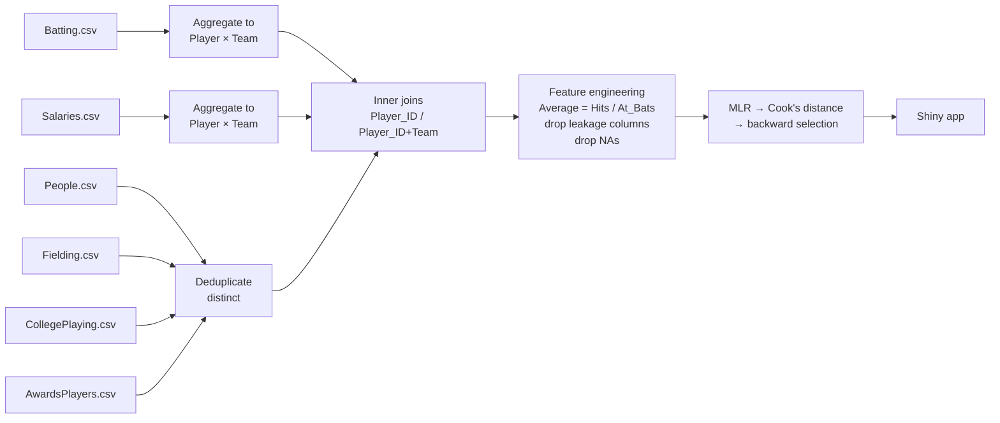

# What Drives a Baseball Player's Batting Average? MLB Regression Analysis

**A statistical modeling project that combines 6 tables from the Lahman Baseball Database (150+ years of MLB data) into one analytical dataset, then uses multiple linear regression, outlier diagnostics and backward stepwise selection to find which factors explain batting average. The results are presented in an interactive R Shiny app.**


---

## Overview

| | |
|---|---|
| **Business question** | Which player attributes (experience, position, team, salary, handedness, college, awards…) are significant predictors of batting average? |
| **Data** | Lahman Baseball Database, 1871–2022: 112K+ batting records, 149K+ fielding records and 20K+ player profiles |
| **Approach** | Multi-source data integration → feature engineering → EDA and correlation analysis → MLR → Cook's distance outlier removal → backward selection (AIC) → model comparison |
| **Tools** | R, dplyr, tidyverse, data.table, olsrr, corrplot, ggplot2, Shiny, shinycssloaders |
| **Team** | Group project with Tyler Toren (graduate course STA 631: Statistical Modeling and Regression) |

## Key results

- **Combined 6 source tables** into one modeling dataset at the player × team grain, using composite keys (`Player_ID + Team`).
- **Compared 16 regression models** side by side on R² and F-statistic, in a model comparison table built into the app.
- **Selected final model:** `Average ~ log(Games_Played) + Position + Team`, with **R² ≈ 44.5%** before outlier removal.
  - Variables that are *components* of batting average were deliberately excluded to prevent **target leakage**: hits, at-bats, runs, doubles, walks, strikeouts and stolen bases.
  - `School_Playing` was dropped because it raised R² but risked **overfitting**.
  - `Salary` was dropped because it added little explanatory power.
  - `Games_Played` was log-transformed because its distribution was heavily right-skewed.
- **Removed influential outliers** with Cook's distance (threshold `4/n`) and showed how model fit improves on the cleaned data.

## App walkthrough

The Shiny app has two modes:

| Mode | What it shows |
|---|---|
| **Automatic** | Data story → correlation matrix → actual vs. predicted scatter (with and without outliers) → Cook's distance plot → backward-selection AIC table → adjusted R² of the selected model |
| **Manual** | Distribution checks (Games_Played, log(Games_Played), log(Salary)) and a comparison table of 16 candidate models with F-statistic and R² |

## Data sources

All data comes from the [Lahman Baseball Database](https://sabr.org/lahman-database/) (public, CC BY-SA 3.0).

| File | Grain | Rows | Used for |
|---|---|---|---|
| `Batting.csv` | Player × season × stint | 112,183 | Games, at-bats, hits, runs, 2B, 3B, HR, BB, SO, SB |
| `People.csv` | Player | 20,676 | Birth country, height, weight, batting/throwing hand |
| `Fielding.csv` | Player × season × stint × position | 149,365 | Fielding position |
| `Salaries.csv` | Player × season × team | 26,428 | Salary |
| `CollegePlaying.csv` | Player × school × year | 17,350 | College attended |
| `AwardsPlayers.csv` | Player × award × year | 6,531 | Awards won |
| `mlbbat10.csv` | Player (2010 season) | 1,199 | Early exploratory models |

## Data pipeline



## Source-to-target mapping (STTM)

**Target: `final_data`** (grain: one row per player × team × position × college × award combination after inner joins)

| Target column | Source file.column | Transformation / business rule |
|---|---|---|
| Player_ID | Batting.playerID | Renamed; join key. Dropped before modeling |
| Team | Batting.teamID | Renamed; part of composite join key with Fielding and Salaries |
| Games_Played | Batting.G | `SUM(G)` grouped by Player_ID, Team; log-transformed in the final model |
| Runs | Batting.R | `SUM(R)` by Player_ID, Team |
| Double | Batting.X2B | `SUM(X2B)` |
| Triples | Batting.X3B | `SUM(X3B)` |
| Home_Runs | Batting.HR | `SUM(HR)` |
| Walks | Batting.BB | `SUM(BB)` |
| Strike_Outs | Batting.SO | `SUM(SO)` |
| Stolen_Base | Batting.SB | `SUM(SB)` |
| **Average** (target variable) | Batting.H, Batting.AB | `SUM(H) / SUM(AB)`; `NaN` (0 at-bats) set to 0. H and AB are dropped afterwards |
| Birth_Country | People.birthCountry | Renamed; joined on Player_ID |
| Height, Weight | People.height, People.weight | Kept for the correlation matrix; excluded from the model |
| Batting_Hand | People.bats | Renamed (L / R / B) |
| Throwing_Hand | People.throws | Renamed (L / R) |
| Position | Fielding.POS | Renamed; joined on Player_ID + Team; categorical |
| Salary | Salaries.salary | `SUM(salary)` by Player_ID, Team; joined on Player_ID + Team |
| School_Playing | CollegePlaying.schoolID | Renamed; joined on Player_ID |
| Awards | AwardsPlayers.awardID | Renamed; joined on Player_ID |
| (all) | — | Exact duplicate rows removed with `distinct()`; rows with any NA removed with `na.omit()` |

## Repository structure

```
├── appFinal.r                   # Final Shiny app (data pipeline + models + UI)
├── New Model Description.Rmd    # Rationale for the final model
├── STA_631_Final_Project_Copy.Rmd / .nb.html   # Exploratory notebook
├── Optimized.R, app*.r, *Worksheet*.R          # Earlier iterations
└── Dataset/                     # Lahman source CSVs
```

## How to run locally

```r
install.packages(c("tidyverse", "dplyr", "ggplot2", "corrplot", "Lahman", "purrr",
                   "olsrr", "shiny", "shinycssloaders", "rstudioapi"))
# Open appFinal.r in RStudio and click "Run App"
# (the script sets the working directory to its own folder)
```

## Skills demonstrated

`Statistical Modeling` · `Multiple Linear Regression` · `Feature Selection (Backward Stepwise / AIC)` · `Outlier Detection (Cook's Distance)` · `Log Transformation` · `Model Evaluation (R², F-statistic)` · `Overfitting & Target-Leakage Prevention` · `Data Integration` · `Multi-table Joins` · `Data Cleaning` · `EDA` · `Correlation Analysis` · `R Shiny` · `Sports Analytics` · `Team Collaboration (Git)`

---

**Authors:** Mageshwaran Anbazhagan · Tyler Toren
